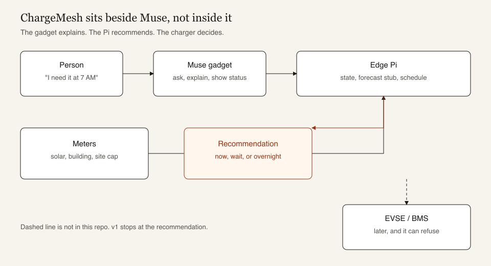
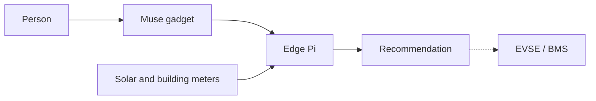
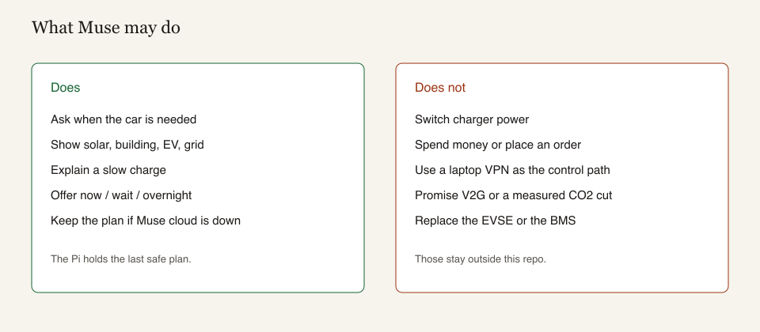

# Architecture





The solid path is v1. The dashed path is phase 4, and only after a person confirms.

## Layers

| Layer | Runs on | Job |
| --- | --- | --- |
| Face | Muse gadget | Ask for departure. Read the recommendation back. |
| Plan | Raspberry Pi, local files | Hold meter samples, car deadlines, and the last schedule. |
| Actuator | EVSE and the car's BMS | Apply or refuse power. Not this repo. |

Muse cloud is optional for the sentence. It is not in the control loop. If the phone cannot reach Muse, the Pi still has the file, and a Linux gadget on that Pi can print it.

## What the Pi stores

One JSON file, fixed path, not chosen by the chat:

```text
cars[]        name, arrival, departure, target SOC, max kW
building_kw   latest meter
solar_kw      latest meter
site_limit_kw sanctioned load, set by the site, not by the chat
```

The chat may update a departure. It may not update `site_limit_kw`.

## Safety order

1. Site cap and the EVSE rating are hard limits.
2. A car that will miss its departure is scheduled before a car that has slack.
3. The recommendation is text until phase 4.
4. In phase 4 the EVSE still has the last word. A refused profile is shown, not retried in a loop.



## What is deliberately absent

No laptop VPN in the path. A VPN on the phone does not cover a separate board, and routing charger decisions through that session would hide the failure when the VPN drops.

No payments. No Swiggy-style "place the charge." The person still plugs in and still pays the DISCOM.

No voice in v1. The ESP32 path is text. Speech is a later `start_tts` change, not part of the estimate.
